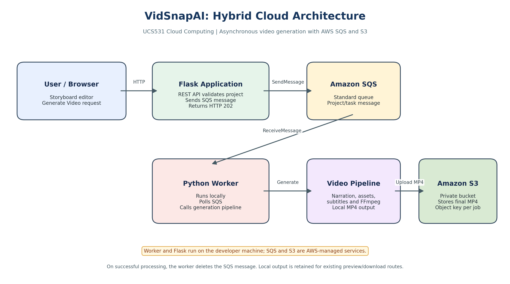

# VidSnapAI: Cloud-Based AI Video Generation

VidSnapAI is an AI-powered short-form video generation application built with Python and Flask. It transforms user-prepared storyboards into rendered videos using AI-generated scripts, narration, stock footage, subtitles, and FFmpeg.

This project extends the original application with an asynchronous cloud workflow using **Amazon Simple Queue Service (SQS)** and **Amazon Simple Storage Service (S3)**.

**Course:** UCS531 - Cloud Computing  
**Project type:** Individual project

## Features

### Video generation
- User registration, login, and session management.
- Project creation, editing, and deletion.
- AI storyboard generation using OpenAI.
- Editing hooks, endings, narration, and scenes.
- Adding, deleting, and reordering scenes.
- Stock footage search using Pixabay.
- Narration generation using ElevenLabs.
- Subtitle generation using faster-whisper.
- Video processing and rendering using FFmpeg.
- Preview and download completed MP4 videos.

### AWS cloud integration
- Asynchronous video-generation requests using Amazon SQS.
- Separate Python worker to consume queued requests.
- Generated MP4 uploads to Amazon S3.
- Project- and job-specific S3 object keys.
- HTTP 202 Accepted response when a generation request is queued.

## Architecture



**Architecture type: Hybrid cloud prototype**

Flask and the Python worker currently run locally. Amazon SQS and Amazon S3 are AWS-managed services. The worker is not currently deployed on EC2.

### Request lifecycle

1. The user clicks **Generate Video** in the storyboard editor.
2. Flask sends a generation request to Amazon SQS.
3. Flask returns HTTP 202 Accepted with a queued status.
4. The Python worker polls SQS and receives the request.
5. The worker runs the existing video-generation pipeline locally using FFmpeg.
6. The completed MP4 is uploaded to the private S3 bucket.
7. After successful processing, the worker deletes the SQS message.

## AWS resources

| Resource | Configuration |
|---|---|
| AWS Region | `us-east-1` |
| S3 bucket | `vidsnapai-cloud-pp` |
| SQS queue | `vidsnapai-generation-queue` |
| S3 security | Private bucket, Block Public Access enabled, SSE-S3 |

Example S3 object:

`projects/11/jobs/8/final_reel.mp4`

## Technology stack

- Python 3.13
- Flask and Flask-SQLAlchemy
- SQLAlchemy and SQLite
- Flask-Login
- OpenAI API
- ElevenLabs API
- Pixabay API
- faster-whisper
- FFmpeg and FFprobe
- Boto3
- Amazon S3 and Amazon SQS
- HTML, CSS, and JavaScript

## Installation

1. Clone the repository:

   ```bash
   git clone -b aws-cloud-integration https://github.com/pramitt9/AIReelGenerator.git
   cd AIReelGenerator
   ```

2. Create a virtual environment:

   ```powershell
   py -3.13 -m venv .venv
   ```

3. Install dependencies:

   ```powershell
   .\.venv\Scripts\python.exe -m pip install -r requirements.txt
   ```

4. Create your local environment file:

   ```powershell
   Copy-Item .env.example .env
   ```

5. Configure the required API keys, Flask secret, and AWS settings in `.env`.

6. Install FFmpeg and FFprobe and ensure they are available on PATH.

7. Start the Flask application:

   ```powershell
   .\.venv\Scripts\python.exe run.py
   ```

8. In a separate terminal, start the worker:

   ```powershell
   .\.venv\Scripts\python.exe worker.py
   ```

## Environment variables

Configure these locally in `.env`:

```env
SECRET_KEY=your_secure_secret_key
OPENAI_API_KEY=your_openai_api_key
ELEVENLABS_API_KEY=your_elevenlabs_api_key
PIXABAY_API_KEY=your_pixabay_api_key

AWS_ACCESS_KEY_ID=your_temporary_access_key
AWS_SECRET_ACCESS_KEY=your_temporary_secret_key
AWS_SESSION_TOKEN=your_temporary_session_token
AWS_DEFAULT_REGION=us-east-1
S3_BUCKET_NAME=vidsnapai-cloud-pp
SQS_QUEUE_URL=your_sqs_queue_url
```

AWS Academy Learner Lab credentials are temporary and must be refreshed when the session expires.

**Never commit `.env`, AWS credentials, or API keys.**

## Verified implementation

Testing confirmed that the application successfully:

- Sent generation requests to SQS and returned HTTP 202.
- Received messages through the Python worker.
- Executed the existing video-generation pipeline.
- Generated local MP4 files.
- Uploaded completed videos to Amazon S3.
- Deleted successfully processed SQS messages.

Two separate generation jobs were successfully processed and uploaded to S3 during testing.

## Limitations

- The Flask application and worker currently run locally.
- The worker must remain active while processing queued jobs.
- Browser-based persistent job-status polling is not yet implemented.
- Failure handling, retries, dead-letter queues, idempotency, and visibility-timeout extension require further hardening.
- This is an academic prototype, not a highly available production deployment.

## Future improvements

- Deploy the worker on Amazon EC2.
- Add database-backed job states.
- Implement browser polling or server-sent events for progress updates.
- Configure SQS retries and a dead-letter queue.
- Apply least-privilege IAM permissions.
- Add monitoring and production deployment support.

## Course alignment

This project demonstrates UCS531 concepts including AWS offerings, Amazon S3, Amazon SQS, messaging in the cloud, RESTful web services, cloud architecture, and cloud security considerations.

## Project documentation

The detailed project report and architecture diagram are available in the [`docs`](docs/) directory.
